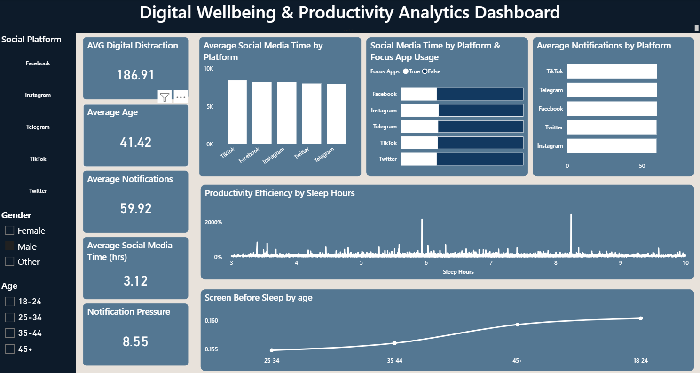
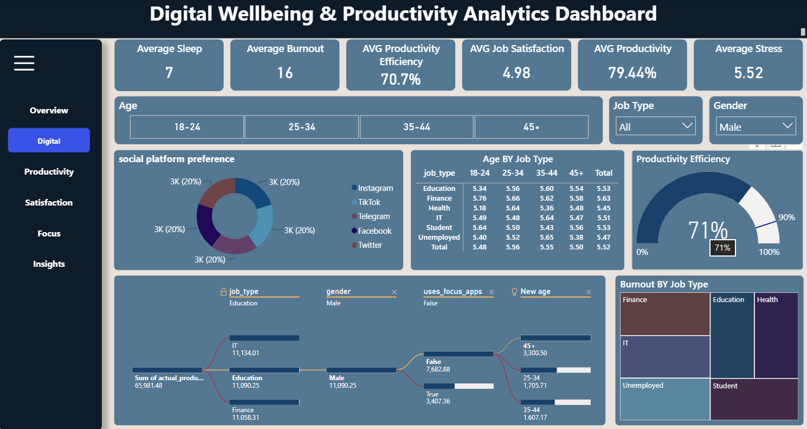

# 📱 Digital Wellbeing & Productivity Analytics

### Does social media really cost us our productivity?

---

## 🎯 The Problem

We spend hours on social media every day, and we get notifications all day long. This project explores how **digital habits** (platform use, notifications, screen time before sleep) connect to **sleep, stress, burnout, and productivity** across different ages and job types.

---

## 📸 Dashboard Preview

  

---

## 🔍 What I Analyzed

- 📲 **Social media use**: time spent and preference by platform
- 🔔 **Notifications**: average volume and notification pressure
- 😴 **Sleep** and its link to productivity efficiency
- 🌙 **Screen time before sleep** by age group
- 🎯 **Focus apps** usage and its effect on productivity
- 😰 **Stress and burnout** by job type and age group
- 💼 **Job satisfaction** and productivity across groups

---

## 📊 Headline Numbers

| Metric | Value |
|:---|:---:|
| Avg social media time | **3.12 hrs** |
| Avg notifications | **59.92** |
| Avg sleep | **7 hrs** |
| Avg productivity | **79.44%** |
| Avg productivity efficiency | **70.7%** |
| Avg stress | **5.52** |
| Avg job satisfaction | **4.98** |

---

## 💡 Key Insights

- **Platform use is evenly split:** each of the five platforms holds about 20% of users, so no single platform dominates.
- **Stress is similar everywhere:** average stress sits around 5.4 to 5.8 across all job types and age groups, so it does not depend much on age or profession.
- **Productivity efficiency (70.7%) is below the 90% target** shown on the dashboard, which leaves clear room to improve.
- **Sleep alone does not explain productivity:** efficiency moves up and down across all sleep hours with no clear trend, which suggests other factors (like notifications and focus apps) matter too.
- **The average person gets 7 hours of sleep** but spends over 3 hours a day on social media and receives close to 60 notifications.

> ✏️ *Add 1 or 2 more insights from the Productivity, Satisfaction, and Focus pages of your report.*

---

## 🛠️ Tools & Workflow

| Step | Tool | What I did |
|:---|:---|:---|
| 1️⃣ Prepare | Power Query | Cleaned and prepared the dataset |
| 2️⃣ Model | Power BI + DAX | Built measures for productivity efficiency and notification pressure |
| 3️⃣ Visualize | Power BI | Multi-page report with slicers, decomposition tree, gauge, and treemap |

---

## 🚀 How to Explore It

1. Download `Digital_Wellbeing.pbix` from this repo
2. Open it in **Power BI Desktop**
3. Use the sidebar to move between pages (Overview, Digital, Productivity, Satisfaction, Focus, Insights)
4. Filter by age, gender, job type, and platform

---

## 📬 Let's Connect

⭐ *If you liked this project, drop a star!*

